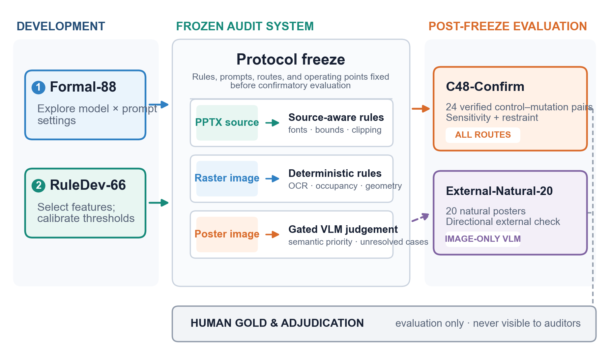
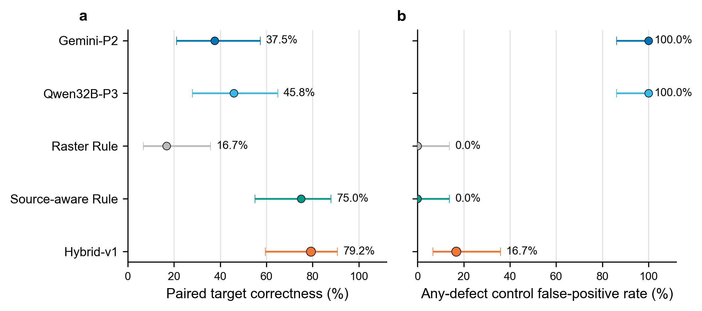
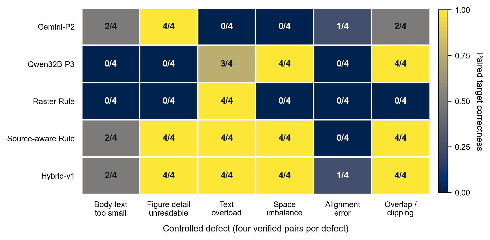
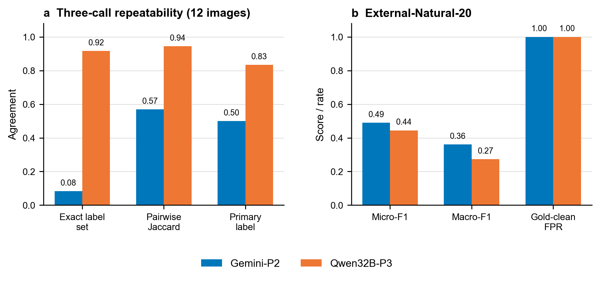

# Counterfactual Auditing of Scientific Posters: Allocating Evidence between Vision-Language Models and Source-Aware Rules

[Author names, affiliations, and corresponding-author details to be completed before submission.]

## Abstract

**Purpose:** Vision-language models (VLMs) are increasingly used to critique generated visual documents, but a plausible critique may not correspond to a defect that is present. This study evaluates whether poster auditors detect verified defects while remaining restrained on clean controls.

**Methods:** Formal-88 compared four VLM configurations and three prompts on 88 scientific posters. Deterministic features were then calibrated on a separate development set and frozen before confirmatory evaluation on 24 clean-control/single-defect pairs spanning six defects and four unseen layouts. We compared two image-only VLM operating points, raster rules, source-aware rules, and a selectively routed Hybrid.

**Results:** Source-aware rules correctly separated 18/24 pairs, produced no moderate or severe allegation on clean controls, and achieved the highest micro-F1 (0.857). The Hybrid separated 19/24 pairs, but its one-pair gain was not significant (*p* = 1.0) and it introduced four clean-control allegations. The two VLM-only conditions separated 11/24 and 9/24 pairs and alleged at least one defect on every clean control. Similar over-allegation appeared on 20 post-freeze author-created posters.

**Conclusion:** Conventional defect recall can conceal unsupported criticism. In source-retaining poster-generation pipelines, deterministic source evidence provides the strongest specificity anchor for measurable defects; VLM judgment is better used as gated semantic escalation than as a default evaluator. Findings about source-aware auditing remain limited to controlled 16:9 PosterCS artifacts.

**Keywords:** scientific document generation; multimodal evaluation; model-as-a-judge; document layout analysis; source-aware auditing; counterfactual evaluation

## 中文摘要

自动生成科研海报常借助视觉语言模型发现排版与可读性问题，但模型能给出流畅意见，并不意味着它确实看到了当前海报中的缺陷。本研究提出一种反事实海报审计协议：将干净对照与只含一个已核验缺陷的变异版本配对，只有审计器发现变异、同时不误报对照时，才记为配对判断正确。Formal-88 首先比较 4 种模型配置、3 类提示策略和 88 张海报，共得到 1,056 条有效预测；随后在独立 RuleDev 数据上校准并冻结规则，在包含 6 类可操作缺陷和 4 种未见布局的 24 组对照/变异对上进行确认性测试。Source-aware Rule-v1 正确区分 18/24 组样本，对干净对照未报告中度或重度缺陷，并取得最高 Micro-F1（0.857）。Hybrid-v1 正确区分 19/24 组，但相对源结构规则仅多识别一组，差异不显著（*p* = 1.0），同时新增 4 个对照误报。Qwen32B-P3 和 Gemini-P2 分别正确区分 11/24 与 9/24 组，且都对全部干净对照至少报告一项缺陷。在冻结后增加的 20 张作者制作海报上，两种 VLM 同样对全部 Gold-clean 海报提出缺陷，并均在 20 张中有 19 张报告图像细节不可读。有限的三次重复调用还显示，Gemini-P2 的标签集合稳定性明显低于 Qwen32B-P3。结果说明，常规缺陷召回率会掩盖缺乏依据的批评和调用不稳定性。可测量的字体、边界和对象几何应优先使用保留的源结构，VLM 更适合作为受控的语义升级通道。源结构结论仍限于 PosterCS 的受控 16:9 海报，外部样本只支持关于 image-only VLM 行为的方向性判断。10 张海报的修复试验只证明实现可行性，不构成独立效果验证。

**关键词：** 科研文档生成；多模态评估；模型裁判；文档版面分析；源结构审计；反事实评测；选择性路由

## 1. Introduction

Scientific posters compress a paper's motivation, method, evidence, and conclusions into a single visual surface. Automating this transformation requires more than summarizing text: a system must select figures, allocate limited space, preserve readable type, and produce a visual hierarchy that supports rapid scanning. Recent paper-to-poster systems and scientific-poster datasets have made this problem increasingly tractable. Paper2Poster combines multimodal content extraction, editable poster construction, and a visual feedback loop, while PosterGen organizes generation through specialized language-model agents [@pang2025paper2poster; @zhang2025postergen]. SciPostLayout further establishes scientific posters as a distinct document-layout problem by providing thousands of annotated examples [@wang2024scipostlayout]. These advances make automated poster creation plausible, but they also create a downstream requirement: generated artifacts must be audited before they are shown, exported, or automatically repaired.

An audit is useful only when its findings are reliable. Existing generation systems can ask a vision-language model (VLM) to comment on balance, readability, alignment, or overflow and then use that feedback to revise a poster [@pang2025paper2poster; @zhang2025postergen]. A fluent critique, however, is not evidence that the named defect is visible in the current artifact. The distinction matters because generation quality and auditor reliability are separate questions. A system may produce a poor poster that an auditor correctly diagnoses, a good poster that an auditor criticizes without support, or a repair that improves the target defect while the auditor continues to repeat the original complaint. Evaluation of the final poster cannot by itself determine which of these cases occurred.

The cost of an unsupported diagnosis is also asymmetric. A missed defect leaves an existing problem unresolved, whereas a false allegation can initiate a new resize, deletion, reflow, or template change and damage an acceptable design. This risk is greater in closed-loop systems, where the auditor's text is converted directly into rendering actions. Model-as-a-judge research has shown that structured prompts and strong models can approximate human preferences, but it has also documented position, verbosity, self-enhancement, inconsistency, and modality-use biases [@zheng2023judging; @liu2023geval; @chen2024mllmjudge]. More recent controlled studies of multimodal judges show that apparently plausible decisions may persist under irrelevant changes or may rely too weakly on the image [@lee2026mmjudgebias; @zou2026judgewithoutseeing]. These findings motivate direct evaluation of the auditor, rather than treating VLM feedback as a trustworthy measurement by default.

An adjacent IJDAR study reaches a related systems-level conclusion in VLM-assisted OCR. Kim et al. separate visually supported text from full intended transcripts and evaluate confidence-guided escalation from PaddleOCR to a VLM [@kim2026hallucinationaware]. Their results show that routing is an auditable cost-accuracy control rather than direct hallucination mitigation. Poster auditing presents a different reliability target: the risky output is not an unsupported text completion but an unsupported defect allegation that may trigger an unnecessary layout edit. This distinction requires clean visual controls, localized defect mutations, and explicit measurement of auditor restraint.

Poster auditing offers an additional source of evidence that image-only evaluation discards. In an editable pipeline, font sizes, text-box bounds, object positions, clipping state, and grouping relationships already exist in the PPTX source. Document-intelligence research has repeatedly used LaTeX, XML, markup, or visual-layout groups to obtain structure that is difficult to reconstruct from pixels alone [@li2020docbank; @wang2021layoutreader; @shen2022vila; @li2022markuplm]. This suggests an evidence-aware design: measurable rendering failures should be checked against source or raster evidence, while VLM judgment should be reserved for semantic importance and genuinely ambiguous visual cases. Such a comparison is intentionally an end-to-end pipeline comparison under different information conditions, not a claim that rules and VLMs receive identical inputs.

This study evaluates that design through three linked stages. Formal-88 compares four VLM capability levels and three prompting strategies on 88 automatically generated posters, yielding 1,056 validated predictions. This exploratory benchmark measures model-, prompt-, and defect-specific behavior and supports error analysis, but it does not independently validate the routing policy derived from those observations. Deterministic features and thresholds are then developed on a separate RuleDev set and frozen before evaluation on Confirmatory-Controlled-48 (C48-Confirm). C48-Confirm contains 24 clean-control and single-defect mutation pairs across six actionable defect types and four new layouts. Five systems are compared: two selected image-only VLM operating points, a raster-only rule baseline, a source-aware rule cascade, and a selective Hybrid. Finally, External-Natural-20 tests whether the two fixed image-only VLM operating points show similar allegation patterns on author-created posters outside the PosterCS renderer. It cannot test source-aware transfer because compatible editable source files are unavailable.

The study asks three primary questions. **RQ1** asks how the behavior of poster-audit VLMs varies across model, prompt, and defect-specific operating points. **RQ2** asks whether control/mutation pairs reveal unsupported allegations that are hidden by defect recall alone. **RQ3** asks how raster evidence, retained source structure, and selectively escalated VLM judgment differ in their sensitivity-specificity trade-offs. Audit-guided repair is treated as a developmental feasibility question rather than a co-equal confirmatory contribution because the current renderer pilot reuses design-stage posters.

The work makes three primary contributions. First, it operationalizes counterfactual poster auditing with verified control/mutation pairs, paired target correctness, and clean-control allegation rates, thereby separating defect sensitivity from restraint. Second, it provides a systematic study of 1,056 model-prompt-image predictions, a limited repeatability diagnostic, and a post-freeze external check showing that apparent VLM competence depends on the operating point and may persist after the target defect is absent. Third, it evaluates an explicit allocation of audit evidence across raster measurements, retained PPTX structure, and gated VLM judgment under a frozen confirmatory protocol. The result is not a claim of universal Hybrid superiority: source-aware checks provide the principal specificity gain, whereas selective VLM escalation yields limited additional sensitivity at a measurable false-positive cost. The accompanying repair library is reported only as developmental implementation evidence.

## 2. Related Work

### 2.1 Scientific-poster and structured-visual generation

Scientific-poster automation combines document understanding, content selection, layout planning, and editable rendering. Paper2Poster is the closest end-to-end system: it extracts multimodal content from a paper, constructs a poster, evaluates visual and textual quality, and uses a Painter-Commenter loop to revise layout problems [@pang2025paper2poster]. PosterGen decomposes a similar task among parser, curator, layout, stylist, and renderer agents and evaluates outputs using a VLM rubric for readability, balance, and aesthetic coherence [@zhang2025postergen]. Both systems demonstrate the practical value of model-generated feedback. Neither use of feedback, by itself, establishes that the commenter distinguishes a genuine defect from a clean but imperfect design.

Dataset and layout research addresses complementary parts of the problem. SciPostLayout provides 7,855 annotated scientific posters and paired paper-poster examples for layout analysis and generation [@wang2024scipostlayout]. PosterLayout formulates content-aware placement on non-empty canvases and evaluates layouts using utilization, non-occlusion, and aesthetic measures [@hsu2023posterlayout]. PosterO represents layouts as hierarchical SVG trees so that language models can generate and edit shape-diverse designs [@hsu2025postero]. These works establish that poster layout has measurable structure, but their principal objective is generation quality rather than the reliability of a defect auditor.

Adjacent structured-visual systems reinforce the value of editability and explicit layout. AutoPresent evaluates the generation of editable slide content and explores iterative model-based improvement [@ge2025autopresent]. Instruction-following layout planning treats the canvas and spatial constraints as explicit reasoning inputs [@zhu2024automaticlayout]. LayoutDiffusion evaluates generated layouts with geometric measures including alignment, overlap, and spacing [@zhang2023layoutdiffusion], while IGD combines multimodal layer generation with both model-based assessment and deterministic graphic metrics [@qu2025igd]. Collectively, this literature supports mixed evaluation, but it leaves open which evaluator should be trusted for each type of defect.

### 2.2 VLM evaluation and model-as-a-judge reliability

Model-as-a-judge methods provide scalable evaluation for outputs that are difficult to score with exact matching. MT-Bench showed that strong language-model judges can approximate human preferences while also exhibiting position, verbosity, and self-enhancement biases [@zheng2023judging]. G-Eval improved alignment with human judgments through explicit evaluation steps and form-based output, yet also reported possible preference toward model-generated text [@liu2023geval]. The central lesson is not that automated judges are unusable, but that agreement at the aggregate level does not remove systematic operating-point bias.

Multimodal evaluation extends these methods to image-conditioned judgments. MLLM-as-a-Judge compares scoring, pairwise comparison, and batch ranking and reports substantial variation, hallucination, and inconsistency across evaluation modes [@chen2024mllmjudge]. Prometheus-Vision trains a fine-grained rubric-conditioned visual evaluator [@lee2024prometheusvision], while VIEScore uses multimodal models to produce interpretable assessments of conditional image synthesis [@ku2023viescore]. Q-Instruct demonstrates that low-level visual-quality feedback can improve multimodal models' sensitivity to perceptual attributes [@wu2024qinstruct]. MLLM-Bench further argues for per-sample criteria when evaluating open-ended multimodal responses [@ge2025mllmbench]. These approaches show that rubrics and task-specific criteria matter, but they do not guarantee that a fixed taxonomy will prevent false diagnoses on structured posters.

Recent meta-evaluation work makes the reliability problem more explicit. MM-JudgeBias uses controlled changes to queries, images, and responses to expose compositional bias, modality neglect, and instability in multimodal judges [@lee2026mmjudgebias]. Work on informativeness bias similarly finds that a VLM judge may prefer a more informative-looking response even when it conflicts with image evidence [@zou2026judgewithoutseeing]. These studies do not prove that the same mechanism causes errors in PosterCS. They do justify an evaluation that tests whether a judge reacts to the specific visual change under study and remains silent on its paired clean control.

Hallucination-aware VLM-OCR provides the closest document-analysis analogue to our evaluation objective. Kim et al. use visible and full transcripts to distinguish visually grounded reading from plausible completion, report abstention separately, and study selective routing through a frozen OCR-confidence threshold [@kim2026hallucinationaware]. Our task differs in both output and counterfactual design. A poster auditor produces actionable defect labels rather than a transcript, its unsafe behavior is an unsupported allegation rather than an invented character span, and retained PPTX geometry provides direct structural evidence unavailable in image-only OCR. We therefore pair each clean poster with a verified single-defect mutation and require the auditor to detect the mutation without assigning the same target to its control.

### 2.3 Document structure and deterministic evidence

Document-intelligence research provides a separate basis for source-aware auditing. DocBank derives token-level layout supervision from LaTeX source rather than relying entirely on manual annotation or visual reconstruction [@li2020docbank]. LayoutReader uses Word XML metadata to construct reading-order supervision and combines textual and spatial information [@wang2021layoutreader]. VILA groups scientific-PDF content according to visual layout to improve structured extraction [@shen2022vila], and MarkupLM jointly models text and markup paths for visually rich documents [@li2022markuplm]. Across different document types, the shared principle is that structure retained by the authoring format is an independent evidence channel.

Poster auditing can use this channel directly. Font size, object bounds, occupancy, overlap, and clipping are properties of the generated artifact, not latent aesthetic preferences. Raster analysis can estimate some of them, but source structure often provides a more precise measurement. At the same time, deterministic geometry cannot fully decide whether a figure is semantically important, whether an asymmetrical composition remains readable, or whether a hierarchy communicates the intended emphasis. Source rules and VLM judgment therefore address different evidence regimes rather than interchangeable versions of the same classifier.

### 2.4 Positioning of this study

Prior work has developed increasingly capable poster generators, structured layout representations, VLM evaluators, and document models. The unresolved question is how to test whether an actionable critique is tied to the defect actually visible in the artifact, especially when a mistaken judgment may trigger an automatic edit. This study addresses that gap through two linked choices: defect-level control/mutation pairs that jointly test sensitivity and restraint, and an explicit comparison of raster evidence, retained source structure, and gated VLM judgment. The objective is neither to propose the strongest poster generator nor to claim a universally superior Hybrid. It is to establish a counterfactual audit protocol and determine which evidence channel can support each decision under a frozen, reproducible operating point.

This positioning complements rather than duplicates hallucination-aware OCR. Dual-reference OCR evaluates whether generated text is visually supported; the present protocol evaluates whether a proposed repair-triggering diagnosis is causally tied to a controlled visual defect. Confidence routing in OCR manages a cost-accuracy operating point, whereas our routing policy allocates heterogeneous evidence sources and exposes the false-allegation cost of semantic escalation. The shared methodological principle is to report accuracy together with the system's failure to abstain or remain silent.

## 3. Task Definition and Study Design

### 3.1 Poster audit task

This study considers the auditing stage of an automatic paper-to-poster pipeline. The base input is a 16:9 poster image rendered at 2400 × 1350 pixels. Image-only vision-language model (VLM) conditions receive only this image. Source-aware conditions additionally receive PPTX features, including font sizes, text-box geometry, picture bounds, and object relationships. The comparison represents alternative information regimes in a practical generation pipeline rather than a same-input contest between model classes.

The audit output is a structured, multi-label record. Each reported issue contains a defect label, severity, location, visible evidence, and a suggested action. Severity 1 denotes a minor imperfection that does not impede the main reading task. Severity 2 denotes a defect that materially reduces reading efficiency, comprehension, or professional presentation, while severity 3 denotes unreadable key content, a broken reading path, or a hard rendering failure. The primary analysis treats severity 2 and 3 as positive findings. `none` is used only when no issue reaches that threshold and cannot co-occur with a positive label.

Reliability is defined by more than the number of defects reported. A useful auditor should detect a defect after it is introduced, remain silent on the paired clean version, point to evidence that supports its judgment, and abstain when the available evidence cannot justify a decision. The confirmatory analysis operationalizes the first two requirements through paired target correctness: a pair is counted as correct only when the mutation is positive for the injected defect and the corresponding control is negative for that defect. Because an auditor can avoid the target-label error while inventing unrelated problems, the study also measures whether any moderate or severe defect is alleged on a clean control.

### 3.2 Operational defect taxonomy

The full Formal-88 audit schema contains nine visible-defect labels: `body_text_too_small`, `figure_detail_unreadable`, `text_overload`, `space_imbalance`, `alignment_error`, `weak_hierarchy`, `overlap_or_clipping`, `asset_missing_or_broken`, and `other`. The controlled experiments focus on the first five labels plus `overlap_or_clipping`, because these six defects can be introduced individually and linked to measurable rendering or layout evidence.

The definitions were revised during pilot annotation to avoid treating every aesthetic preference as a defect. `body_text_too_small` requires body text that cannot be read continuously because of size, contrast, or spacing. `figure_detail_unreadable` applies only when labels, legends, nodes, values, or other details needed to understand a principal figure cannot be distinguished at fit-to-window viewing. `text_overload` requires a reading burden that materially obstructs rapid scanning. Additional bullets or stylistic repetition alone are insufficient. `space_imbalance` requires a large uninformative blank region together with local crowding or a marked imbalance in visual weight. `alignment_error` is limited to non-deliberate deviations that disrupt an identifiable grid, grouping, or reading path. Minor asymmetry and intentional staggered composition remain acceptable. `overlap_or_clipping` requires actual occlusion, boundary overflow, truncation, or loss of meaningful content.

These labels are operational categories rather than a complete or mutually exclusive theory of poster quality. They combine perceptual symptoms and rendering failures because the intended output is an actionable audit. The confirmatory benchmark does not estimate performance for the remaining three labels.

### 3.3 Dataset roles and leakage control

The study separates exploratory comparison, rule development, and confirmation. Formal-88 contains Natural-40 and Exploratory-Controlled-48. Natural-40 comprises 20 paper pairs, with one original and one renderer-v0.6 poster per paper. Exploratory-Controlled-48 comprises 24 control/mutation pairs across six injected defects. Four VLM configurations and three prompting strategies were run on all 88 images, producing 1,056 complete predictions. Formal-88 is used to characterize model and prompt variation, select representative VLM operating points, and identify failure mechanisms. It is not used to confirm the later routing policy because its results informed that policy.

RuleDev is a separate development set for feature selection and threshold calibration. Human acceptance retained 33 pairs, or 66 images, with at least five valid pairs for each controlled defect. The final rule configuration and Hybrid-v1 routing policy were frozen after RuleDev and before the confirmatory benchmark was scored. Formal-88 was not read during rule threshold selection.

Confirmatory-Controlled-48, abbreviated C48-Confirm, is the post-freeze test set. It contains 24 new control/mutation pairs, with four pairs for each label and four new layout families. Its content, visual assets, layout code, and injection parameters differ from RuleDev. File-hash checks found no image duplication with Formal-88 or RuleDev. Human acceptance was based on defect visibility and control cleanliness rather than system success. The VLM runners and rule executors did not access the gold labels.

Gold provenance was recorded separately from model predictions. Annotator A reviewed all 40 Natural-40 posters. Annotator B independently and blindly reviewed a stratified 20-poster subset without seeing candidate labels or system outputs. Thirteen initial disagreements and one additional difference identified during a five-case blind-spot check were adjudicated. On the independently coded subset, primary-label and exact label-set agreement were both 0.400, mean label Jaccard was 0.658, and severity agreement was 0.818 over 22 common-label instances. Controlled pairs used manifest-defined targets but were retained only after human verification that the mutation was visible, its control was clean for that target, and no competing primary defect had been introduced. The final Formal-88 Gold was frozen with SHA-256 `b26afb930f0997f948b7a4fc7d6830c2111c0f7d543bb5d47a2b4e4c445c6750`; Appendix A gives the full provenance and freeze record.

The current design favors internal validity. C48-Confirm tests whether a frozen auditor responds to a known change under the included layouts and severities. To probe a narrower form of external validity, External-Natural-20 was added after the internal systems were frozen. It contains 20 author-created conference posters sampled deterministically from the Paper2Poster dataset. Annotator A blind-labeled all 20 posters, annotator B independently blind-labeled a stratified subset of ten, and two records were adjudicated. Exact label-set and primary-label agreement were both 9/10 on the independent subset. This set evaluates only the two preselected image-only VLM operating points. It does not test transfer of Source-aware Rule-v1 or Hybrid-v1 because compatible PPTX structure is unavailable.

**Figure 1. Study stages and evidence allocation.** Formal-88 is exploratory, whereas RuleDev-66 is used only for feature selection and threshold calibration. Rules, prompts, evidence routes, and operating points are then frozen before C48-Confirm. The center panel shows how source facts, raster measurements, and gated VLM judgments enter the frozen audit system. External-Natural-20 is a post-freeze directional check of the image-only VLM operating points because compatible source structure is unavailable. Human verification creates and adjudicates the evaluation target but is never available to the auditors.

### 3.4 Research hypotheses and interpretation boundaries

Three hypotheses organize the primary study. H1 predicts that VLM audit behavior varies across models, prompting strategies, and defect types. H2 predicts that counterfactual pairs will expose unsupported clean-control allegations that are not visible in mutation recall alone. H3 predicts that evidence channels will occupy different operating regions: retained source structure should improve specificity for measurable defects, while selective VLM escalation may recover semantically ambiguous cases at a false-positive cost. H3 does not presuppose that a Hybrid will dominate the source-aware cascade.

The analysis does not treat source-aware and image-only systems as equivalent-input competitors. Instead, it asks which evidence should be used when the source representation is available in an automatic generation pipeline. Claims about natural-poster robustness, cross-generator transfer, and universal Hybrid superiority are outside the current evidence boundary. Audit-guided repair is reported separately as developmental evidence because the repair pilot influenced the renderer design.

## 4. Methods

### 4.1 Exploratory VLM benchmark

Formal-88 was used to measure model-, prompt-, and defect-dependent behavior before designing the evidence-routing framework. Every condition received the same frozen 2400 × 1350 poster images and returned the same JSON structure. The four model configurations were Gemini Flash, Qwen3-VL-8B-Instruct, Qwen3-VL-32B-Instruct, and GLM-VL Flash. The two Qwen variants provided a within-family size comparison, while Gemini, Qwen, and GLM provided cross-family observations. They were not interpreted as a strict ordinal capability ladder.

Three prompts were evaluated. P1 was a task-adapted Paper2Poster-style visual critique baseline rather than a verbatim reproduction of the original local-panel commenter [@pang2025paper2poster]. P2 supplied the frozen taxonomy and direct checking rules. P3 required the model to identify localized visible evidence before mapping it to a label, region, and severity. All prompts shared the same output schema and positive threshold. Temperature was set to zero where supported. Gemini used a zero thinking budget, while Qwen and GLM used their OpenAI-compatible JSON-object modes followed by the same local schema and semantic validation. Appendix B records the provider model IDs, frozen prompt locations, schema, preprocessing, retry policy, interruption recovery, and hash-based reproduction procedure.

The inference runner had no access to gold labels, sample roles, or control/mutation identities. Invalid JSON, schema violations, and API failures were retried up to five times with exponential backoff. Raw attempts were preserved, and deterministic normalization merged duplicate observations of the same label without introducing or deleting labels. Final failures would have been excluded rather than converted to `none`. After missing-only recovery, however, all 1,056 expected predictions were valid. Formal-88 was analyzed separately for Natural-40 and Exploratory-Controlled-48 so that renderer-specific natural defects did not obscure controlled discrimination.

### 4.2 Continuous feature extraction and rule calibration

Rule development began with measurement rather than binary decisions. The raster track extracted quantities such as OCR-derived line height, character count, foreground balance, grid occupancy, and panel-edge residuals. The source track extracted PPTX-derived font sizes, character counts, text density, picture display geometry, empty-region geometry, panel alignment, and overlap or clipping evidence. Features were normalized to a common 2400 × 1350 input frame where necessary, and localized evidence was retained for later audit explanations.

Thresholds were selected only from the accepted RuleDev pairs. Each candidate detector defined a positive region, a negative region, and, where the two did not meet, an abstention interval. This gap prevented borderline measurements from being forced into a clean or defective state. Threshold selection used leave-one-pair-out evaluation, required low control false-positive behavior, and was followed by cross-label checks on non-target mutations. Ten detectors met the frozen quality gate. All six source-aware detectors were activated. Four raster detectors were activated for body-text size, text overload, space imbalance, and alignment. Raster detection of figure readability and overlap/clipping was disabled and fixed to abstain because whole-poster OCR could not localize figure detail reliably and OCR absence could not prove that clipping was absent.

This calibration strategy treats abstention as an intended safety behavior. A disabled or non-applicable detector does not return `none`. It passes the case to an explicitly defined fallback or leaves it unresolved. Development performance is not reported as generalization evidence because RuleDev contains only five or six accepted pairs per label and is tied to the project renderer.

### 4.3 Frozen audit systems

Five systems were compared on C48-Confirm. Gemini-P2 and Qwen32B-P3 were representative image-only VLM operating points selected from the exploratory benchmark. Raster Rule-v1 emitted only positive decisions from the active raster detectors and otherwise abstained. Source-aware Rule-v1 used source detectors first and their specified raster fallbacks. Hybrid-v1 applied a frozen, label-specific routing policy rather than taking a union or intersection of all outputs.

For `body_text_too_small` and `text_overload`, a decisive source or raster rule determined the output, while unresolved cases were routed to Gemini-P2. `space_imbalance` used the corresponding source/raster cascade with Qwen32B-P3 as its unresolved-case VLM. `alignment_error` used the source rule when a named grid was available, otherwise the raster alignment feature, and escalated unresolved cases to Gemini-P2. `overlap_or_clipping` was decided by the source rule when available, with Gemini-P2 used only on unresolved cases because the raster detector was disabled.

Figure readability required a different route. The source rule first measured whether the displayed picture scale made internal detail plausibly unreadable. A positive scale gate then required Gemini-P2 to confirm that the affected detail was semantically important for understanding the poster. A negative source decision suppressed the same-label VLM allegation. This two-stage route was intended to prevent every small decorative image from being treated as a substantive failure, although it retained the risk that semantic confirmation would add unsupported findings. `weak_hierarchy` was assigned to Gemini-P2, while `asset_missing_or_broken` and `other` were deferred from automatic Hybrid-v1 output because no calibrated route was available.

The source-aware rule and Hybrid systems receive information unavailable to the VLM-only baselines. Their comparison therefore evaluates end-to-end audit strategies within a source-retaining generation system. It should not be read as evidence that deterministic algorithms are intrinsically better visual reasoners.

### 4.4 Construction and verification of C48-Confirm

C48-Confirm was constructed only after the rule thresholds and routing policy were frozen. The benchmark contains four control/mutation pairs for each of six labels, for 24 pairs and 48 posters in total. The `magazine`, `sidebar_grid`, `horizontal_bands`, and `mosaic` layouts were introduced to reduce reuse of the development layouts. Within each pair, only the target defect was intended to change. Two mutations per label were designed as moderate and two as severe. PNG and PPTX files, injection parameters, random seeds, and file hashes were retained.

Human verification checked whether the target defect was visible at fit-to-window viewing, whether the control lacked that target, and whether the mutation introduced another failure that would replace the intended primary issue. The acceptance rules were particularly conservative for alignment and text overload. An alignment mutation had to disrupt grouping or reading through a clearly non-deliberate deviation, while decorative asymmetry was allowed. A text-overload mutation had to impair scanning across principal text regions while preserving normal font size and avoiding clipping. Pairs that failed these conditions were rebuilt or excluded without reference to rule or VLM outputs. The accepted set was then frozen before confirmation inference and scoring.

The exact monitor diagonal, browser viewport, and zoom level used during the earlier fit-to-window judgments were not prospectively recorded. The criterion should therefore be understood as a workstation-specific digital-screen judgment rather than a calibrated physical viewing condition.

### 4.5 Metrics and statistical analysis

Mutation target recall measures how often the injected defect was detected. Target-control false-positive rate measures how often the same target label was incorrectly reported on the paired control. Paired target correctness requires both a correct mutation decision and a correct target-label control decision. Any-defect control false-positive rate records whether a system reported at least one moderate or severe defect of any label on a clean control. This last metric distinguishes target discrimination from a broader tendency to continue finding unrelated problems.

Secondary multi-label metrics include micro- and macro-averaged F1, exact match, and mean Jaccard similarity. Per-target results are reported because each controlled label has only four pairs and aggregate scores can conceal systematic failures. Paired-correctness confidence intervals use 95% Wilson intervals in the confirmatory result table. For C48-Confirm, the primary statistical contrast is Hybrid-v1 versus Source-aware Rule-v1 on paired target correctness, because this comparison tests whether selective VLM escalation adds reliable value beyond retained source structure. Hybrid-v1 comparisons with Gemini-P2, Qwen32B-P3, and Raster Rule-v1 are secondary contextual contrasts; their exact McNemar p-values are Holm-corrected as one three-test family. All comparisons report absolute paired-correctness differences and discordant-pair counts. Macro-F1 is the unweighted mean over labels with at least one Gold positive in the relevant split. A supported label that is never predicted receives F1 = 0, while a zero-support label is reported as `NA` and excluded from that split's macro average.

### 4.6 Limited operating-point repeatability diagnostic

Repeatability was evaluated after the frozen C48 confirmation without changing model selection, prompts, thresholds, or primary scores. A deterministic subset contained one accepted pair for each of the six actionable labels (12 images). For each selected image and VLM operating point, the frozen confirmation call was compared with two fresh calls made with the same image, model, prompt, schema, and temperature. The diagnostic reports three-way exact label-set agreement, mean pairwise Jaccard similarity, three-way primary-label agreement, and mean latency. It measures API-level repeatability for the selected calls; it is not a second performance test and does not replace the frozen C48 result.

### 4.7 Developmental repair executor

The repair component maps selected audit findings to deterministic rendering actions, including figure-space allocation, text budgets, semantic panel variants, and portrait-figure routing. The pilot evaluates geometric changes and human judgments on ten development posters. Because these posters influenced renderer design, the repair results are treated as feasibility evidence rather than an independent test. No repair result contributes to the C48-Confirm comparison.

## 5. Results

### 5.1 Model and prompt effects on Formal-88

All 1,056 expected predictions passed the final validation checks, giving complete coverage for four model configurations, three prompts, and 88 posters. On Natural-40, Gemini-P3 achieved the highest macro-F1 at 0.634 (95% cluster-bootstrap CI 0.520–0.747), followed by Gemini-P2 at 0.610 (0.512–0.745), Qwen32B-P2 at 0.530 (0.480–0.577), Gemini-P1 at 0.514 (0.459–0.570), and Qwen32B-P3 at 0.496 (0.436–0.551). GLM's best condition was P2 at 0.252. Qwen8B returned valid structured responses in all 264 model–prompt–image cases but did not emit any severity-2 or severity-3 defect, resulting in a macro-F1 of zero under all three prompts. The zero score was therefore a systematic miss pattern rather than an API or parsing failure.

Prompt effects depended on the model. For Qwen32B on Natural-40, P2 improved macro-F1 over P1 by 0.334 and P3 improved it by 0.300; both differences remained significant after Holm correction (*p* = .0012). On Exploratory-Controlled-48, Qwen32B-P3 improved paired correctness over P1 by 0.417 (adjusted *p* = .0234) and over P2 by 0.375 (adjusted *p* = .0430). GLM also improved from P1 to P2 on Natural-40 by 0.137 (adjusted *p* = .0230). In contrast, no pairwise prompt difference for Gemini remained significant after correction. Taxonomy and evidence constraints can therefore improve a weak operating point, but the effect does not transfer uniformly across model families.

The two data components also favored different operating characteristics. Gemini-P3 led Natural-40, whereas Gemini-P2 achieved the highest paired correctness on Exploratory-Controlled-48 at 15/24 (62.5%, 95% CI 41.7–79.2%). Qwen32B-P3 followed at 13/24 (54.2%, 33.3–75.0%). Gemini-P2 combined 75.0% mutation recall with a 50.0% any-defect control false-positive rate. Qwen32B-P3 was less sensitive at 54.2% but made no moderate or severe allegations on the exploratory controls. These results motivated the selection of a comparatively sensitive Gemini condition and a comparatively conservative Qwen condition for error analysis. They did not constitute confirmation of the subsequent Hybrid route.

Natural-40 itself covered only three moderate or severe labels: `overlap_or_clipping` in 38 images, `figure_detail_unreadable` in 21, and `space_imbalance` in four. Its macro-F1 therefore describes recurring defects of this renderer rather than broad nine-label coverage. The dominance of clipping reflects the renderer's automatic truncation and ellipsis behavior and limits comparisons with other poster-generation systems.

### 5.2 Error mechanisms in the selected VLM configurations

The selected Gemini-P2 and Qwen32B-P3 conditions failed in different ways on Natural-40. Gemini produced 55 true positives, 32 false positives, and eight false negatives. Qwen produced 47 true positives, 25 false positives, and 16 false negatives. Gemini was therefore more sensitive but more likely to add unsupported labels, while Qwen reduced some over-reporting at the cost of twice as many misses.

Figure readability exposed the clearest prior-driven pattern. Both configurations recalled all 21 positive Natural-40 instances, yet their precision was only 0.553 for Gemini and 0.525 for Qwen. Among 13 original/v0.6 pairs in which the human gold indicated that unreadable figure detail had been repaired, Gemini recognized the transition in only 2/13 cases and Qwen in 0/13. Gemini continued to report the defect on both versions in 11 pairs, and Qwen did so in all 13. High recall in this category therefore did not imply sensitivity to the actual repair.

Semantic-neighbor confusions were also systematic. On Exploratory-Controlled-48, Gemini failed all four `text_overload` mutations but assigned another defect to each, often `space_imbalance`. On Natural-40, Gemini generated eight unsupported `weak_hierarchy` labels, while Qwen added five unsupported `text_overload` labels. The conservative Qwen operating point also missed all four body-text and all four alignment mutations in the exploratory controlled set, together with 12 Natural-40 clipping instances and all four space-imbalance instances. A lower false-positive count was therefore not equivalent to broad reliability.

These observations ruled out simple VLM ensembling. A union would retain high-frequency figure allegations and increase repair-triggering false positives. An intersection would inherit Qwen's systematic misses for body text and alignment. The error analysis instead supported defect-specific evidence allocation: measurable source facts should be checked directly, while VLM judgment should be reserved for cases requiring semantic importance or global visual interpretation. That proposal was developed on RuleDev and tested only after freezing on C48-Confirm.

### 5.3 Confirmatory comparison on C48-Confirm

Table 1 summarizes the five frozen audit systems. Hybrid-v1 obtained the highest paired target correctness, with 19 of 24 pairs correct (79.2%, 95% Wilson CI 59.5–90.8%). The Source-aware Rule cascade followed at 18/24 (75.0%, 55.1–88.0%). The two image-only VLM conditions were lower: Qwen32B-P3 reached 11/24 (45.8%, 27.9–64.9%), and Gemini-P2 reached 9/24 (37.5%, 21.2–57.3%). Raster Rule-v1 detected only 4/24 pairs (16.7%, 6.7–35.9%).

| System | Paired correctness | Mutation recall | Target-control FPR | Any-defect control FPR | Micro-F1 |
|---|---:|---:|---:|---:|---:|
| Gemini-P2 | 9/24 (37.5%) | 45.8% | 12.5% | 100.0% | 0.224 |
| Qwen32B-P3 | 11/24 (45.8%) | 62.5% | 16.7% | 100.0% | 0.385 |
| Raster Rule-v1 | 4/24 (16.7%) | 16.7% | 0.0% | 0.0% | 0.286 |
| Source-aware Rule-v1 | 18/24 (75.0%) | 75.0% | 0.0% | 0.0% | 0.857 |
| Hybrid-v1 | 19/24 (79.2%) | 79.2% | 0.0% | 16.7% | 0.760 |

*Table 1. C48-Confirm audit performance. Source-aware systems receive PPTX-derived structure that is unavailable to the image-only VLM baselines.*

**Figure 2. C48-Confirm audit performance.** (a) Paired target correctness requires detecting the injected defect in the mutation while not assigning the same target label to its matched control. (b) Any-defect control false-positive rate counts any moderate or severe allegation on a clean control. Points show proportions and error bars show 95% Wilson confidence intervals (24 pairs). Source-aware inputs are available only to the rule and Hybrid systems, so image-only and source-aware systems are complementary operating conditions rather than strictly input-matched models.

The primary C48 contrast asks whether Hybrid-v1 improves paired target correctness over Source-aware Rule-v1. Hybrid-v1 was correct on one additional pair and lost none, a 4.2-point difference (1/24; exact McNemar *p* = 1.0). The observed gain therefore provides no evidence that VLM escalation reliably improves the source-aware cascade. Three secondary comparisons place the systems in context. Relative to Gemini-P2, Qwen32B-P3, and Raster Rule-v1, Hybrid-v1 gained 10, 8, and 15 pairs, respectively, with no losses. The corresponding raw exact *p* values were .001953, .007813, and .000061, and Holm-adjusted values within this three-test family were .003906, .007813, and .000183. These secondary differences establish that the source-retaining pipeline outperformed the selected image-only and raster-only baselines on this controlled task, but they do not change the primary Hybrid-versus-Source-aware conclusion.

Specificity explains why the highest paired-correctness score should not be interpreted as universal Hybrid superiority. The Source-aware Rule reported no moderate or severe defect on any of the 24 controls and achieved the highest micro-F1, 0.857. Hybrid-v1 preserved a zero target-control FPR but reported an unrelated defect on four controls, yielding a 16.7% any-defect control FPR and a lower micro-F1 of 0.760. Both image-only VLM configurations reported at least one defect on every clean control. Their target-control FPRs were much lower, at 12.5% for Gemini-P2 and 16.7% for Qwen32B-P3, indicating that many errors were extra diagnoses rather than simple confusion about the injected label.

Raster Rule-v1 occupied the opposite extreme. Its precision was 1.0 and it made no control allegations, but its recall was only 16.7%. This result confirms that conservative raster geometry alone did not provide sufficient evidence for most of the controlled defects. Access to PPTX structure, rather than rule-based classification by itself, accounts for the principal improvement of the source-aware cascade.

### 5.4 Defect-specific behavior

The aggregate results conceal distinct evidence requirements. Hybrid-v1 correctly separated all four pairs for `figure_detail_unreadable`, `text_overload`, `space_imbalance`, and `overlap_or_clipping`. It succeeded on 2/4 body-text pairs and only 1/4 alignment pairs. Source-aware Rule-v1 matched the four perfect Hybrid categories but obtained 0/4 on alignment and the same 2/4 on body-text size. The sole Hybrid gain over the source-aware cascade was therefore one alignment mutation routed to Gemini-P2.

The VLM-only systems showed different, but not safely complementary, profiles. Gemini-P2 detected all four figure-detail mutations without target-label control errors, yet failed all four text-overload pairs and three alignment pairs. Qwen32B-P3 achieved 4/4 for space imbalance and overlap/clipping and 3/4 for text overload, but it missed every body-text and alignment mutation. Its apparent 4/4 mutation recall for figure detail did not produce any correct pair because it also reported the target on all four figure-detail controls. Taking the union of the two VLM outputs would therefore increase sensitivity at the cost of inheriting their allegations, while taking the intersection would preserve their shared misses.

Hybrid-v1 limited this transfer of VLM errors but did not eliminate it. Its four extra control allegations were all `figure_detail_unreadable` findings introduced by the semantic VLM branch on controls whose injected targets belonged to other categories. Thus, the figure route achieved 4/4 target-pair correctness when figure readability was manipulated, yet still reduced whole-benchmark specificity through non-target allegations. This distinction would be invisible if evaluation considered only target-control FPR.

Taken together, C48-Confirm supports two findings. Source-aware deterministic evidence supplied most of the observed accuracy and all of the clean-control specificity of the strongest standalone system. Selective VLM routing recovered one additional controlled case, but the gain was statistically unconfirmed and accompanied by four new allegations. Hybrid-v1 is therefore best interpreted as a measured change in the sensitivity-specificity trade-off and as evidence for selective escalation, not as a generally superior replacement for source-aware auditing.

**Figure 3. Defect-specific paired target correctness on C48-Confirm.** Each cell reports the number of correctly separated control/mutation pairs out of four verified pairs for that defect. A correct pair requires the target label on the mutation and its absence on the matched control. Per-defect counts are diagnostic because each cell contains only four pairs.

### 5.5 Limited repeatability of the selected VLM operating points

The three-call diagnostic revealed a large difference in repeatability between the selected VLM configurations. Across the fixed 12-image subset, Gemini-P2 produced identical label sets in all three calls for only 1/12 images (0.083), with mean pairwise Jaccard similarity 0.569 and three-way primary-label agreement 0.500. Qwen32B-P3 produced identical label sets for 11/12 images (0.917), with mean pairwise Jaccard 0.944 and primary-label agreement 0.833. Mean latency was 6.18 seconds for Gemini-P2 and 38.14 seconds for Qwen32B-P3.

These figures do not revise the frozen performance scores. They show that temperature zero did not guarantee deterministic audit output for the hosted Gemini operating point, whereas the tested Qwen operating point was substantially more repeatable on this subset (Figure 4a). The result strengthens the case for reporting the exact model-prompt operating point and for preventing a single VLM call from directly triggering irreversible repair.

### 5.6 External-Natural-20 post-freeze check

External-Natural-20 provides a small post-freeze check on 20 author-created conference posters outside the PosterCS rendering ecosystem. Gold annotation was completed before inference through a full blind pass, a stratified independent second pass on ten posters, and adjudication of two records. Both VLM conditions received the same aspect-preserving, uncropped image copies with a maximum long side of 2400 pixels. The test is intentionally restricted to Gemini-P2 and Qwen32B-P3; it is not a comparison with source-aware or Hybrid systems.

The two configurations showed the same high-frequency figure-readability pattern observed internally. Gemini-P2 labeled 19/20 posters as `figure_detail_unreadable`, with seven true positives and 12 false positives (precision 0.368, recall 1.000). Qwen32B-P3 produced the same 19/20 frequency and the same true/false-positive split. Both configurations also made at least one moderate or severe allegation on all eight posters whose Gold label set was empty. Overall micro-F1 was 0.490 for Gemini-P2 and 0.444 for Qwen32B-P3; macro-F1 over the four labels with Gold support was 0.361 and 0.274, respectively. Qwen identified five of six `text_overload` cases but none of the eight `body_text_too_small` cases. Gemini identified three of eight body-text cases and two of six text-overload cases.

The external set is too small and label-concentrated to serve as a general benchmark, and the operating points were selected using internal data. It nevertheless provides directional evidence that frequent figure-readability allegations and weak restraint on Gold-clean posters are not confined to PosterCS templates (Figure 4b). Because the posters lack compatible editable structure, this check neither validates nor refutes transfer of Source-aware Rule-v1 or Hybrid-v1.

**Figure 4. Limited repeatability and external post-freeze diagnostics for the selected image-only VLM operating points.** (a) Three-call agreement on a deterministic 12-image C48 subset. (b) Multi-label scores and any-defect false-positive rate on the eight Gold-clean posters within External-Natural-20. These panels address different samples and should not be compared as one common benchmark.

### 5.7 Developmental evidence for audit-guided repair

The repair pilot tested whether audit concepts could be translated into deterministic renderer actions on ten development posters. The action library changed figure allocation, text budgets, semantic panel variants, and portrait-figure routing; all ten outputs passed the automated quality gate at either `pass` (7) or `warn` (3), with no `fail`. Because the same posters informed renderer development, these observations demonstrate implementation feasibility only and do not estimate held-out target resolution or side effects. Detailed geometry, the conservative transfer of human judgments for pixel-identical outputs, and the required Tier-B protocol are reported in Appendix E.

## 6. Discussion

### 6.1 Reliability requires sensitivity and restraint

The results separate two properties that are often collapsed in automatic visual evaluation. An auditor must recognize a defect when it is present, but it must also withhold criticism when the corresponding control is clean. Formal-88 showed that a condition can achieve high recall by repeatedly naming a common defect. C48-Confirm then exposed the practical consequence: both evaluated VLM-only configurations reported at least one moderate or severe issue on every clean control, even though their target-label control false-positive rates were much lower.

This distinction matters because a poster audit is intended to drive action. An unsupported label can trigger a resize, deletion, reflow, or template change that damages an otherwise acceptable poster. Correlation with aggregate human scores is therefore not enough. The audit must connect its judgment to the visual change under test and demonstrate counterfactual specificity. The post-freeze external check found the same absence of restraint for the selected image-only operating points, while the three-call diagnostic showed that repeatability itself can differ sharply between configurations. Related VLM-judge research has likewise found that multimodal evaluators can be inconsistent under controlled perturbations or can underuse visual evidence [@chen2024mllmjudge; @lee2026mmjudgebias; @zou2026judgewithoutseeing]. The present findings do not establish the same causal mechanism, but they show why reliability must be tested at the exact model-prompt operating point rather than inferred from model family or fluent explanations.

### 6.2 Audit decisions should be allocated by evidence type

Source-aware Rule-v1 provided the strongest specificity anchor in C48-Confirm. It achieved 18/24 paired correctness, micro-F1 0.857, and no moderate or severe allegations on the 24 controls. Raster Rule-v1 also made no control allegations but detected only 4/24 mutations. The contrast indicates that the decisive factor was access to source structure, not rule-based classification in isolation.

This result is consistent with document-intelligence research that uses source markup, XML metadata, or layout groups to recover document structure [@li2020docbank; @wang2021layoutreader; @shen2022vila; @li2022markuplm]. PPTX font sizes, object bounds, density, and clipping state are already available in this pipeline. Reconstructing those facts from pixels introduces avoidable uncertainty. The unequal-input comparison is therefore an end-to-end systems result, not proof that deterministic methods are generally superior visual reasoners. Appendix C lists the evidence available to each system and the decision boundary for every audit label.

VLM reasoning remains relevant when structure is not the complete decision. A small figure may be decorative, and an unusual layout may preserve clear grouping. Hybrid-v1 tested one implementation of selective semantic escalation. It recovered one alignment case, raising paired correctness from 18/24 to 19/24, but the difference was not significant and four new figure-readability allegations appeared on controls. Hybrid-v1 should therefore be read as an informative routing experiment rather than the paper's principal performance contribution. The evidence supports conditional VLM use with gates and abstention, not routine addition of VLM outputs to source checks.

This interpretation parallels the caution reported for confidence-guided VLM-OCR routing [@kim2026hallucinationaware]. In both settings, a transparent route can define an operational trade-off without solving the underlying reliability problem. The difference is that poster auditing can exploit retained authoring structure as a direct evidence channel. Routing should therefore be understood as evidence allocation: source facts decide measurable defects, while VLM calls are reserved for semantic questions whose outputs can still be rejected or escalated to a human.

### 6.3 Implications for poster-generation systems

An automatic poster pipeline should retain editable structure throughout generation, auditing, and repair. Each defect should record its evidence source, affected object, measured value where available, and decision route. This lets the repair executor distinguish a geometric fact from a semantic suggestion.

Repair policies should be asymmetric. Source-confirmed clipping can justify a deterministic box adjustment. A VLM-only claim about emphasis or figure importance should request review, seek corroboration, or abstain. Post-repair checks should verify target improvement and absence of new clipping or information loss. Reusing the same VLM as the sole acceptance judge is unsafe given its weak sensitivity to repaired pairs.

No single score defines the preferred deployment. Source-aware Rule-v1 led on micro-F1 and control behavior, while Hybrid-v1 gained one target pair at the cost of four additional control allegations. For automatic repair, this evidence favors source-aware rules with abstention. For decision support, a rule-plus-human escalation path may be preferable to automatic VLM escalation when the semantic branch cannot provide independently verifiable evidence. VLM suggestions remain useful as review candidates when they are localized, visibly grounded, and easy for a human to reject.

### 6.4 Limitations and threats to validity

C48-Confirm contains four pairs per defect, yielding wide intervals. Per-defect counts are diagnostic patterns, not stable population estimates. Synthetic mutations isolate causal changes but may be cleaner than organic failures. The benchmark establishes internal discrimination for the included layouts and severities, not natural-poster performance. Its fit-to-window criterion represents a digital review task, and the exact monitor, viewport, and zoom were not prospectively recorded. It should not be generalized to conference viewing distance or physical poster size without a separate task-based study.

Development and confirmation sets were isolated by construction order, content, layouts, parameters, and hashes, but remain products of the same PosterCS ecosystem. Rules may exploit regularities that do not transfer to other generators. The intentional input asymmetry also prevents a pure model-capability interpretation.

Natural-40 is dominated by this renderer's clipping and ellipsis artifacts, and six taxonomy labels have no moderate or severe positive example. Because Formal-88 informed routing, it cannot independently validate that policy. Only C48-Confirm supports the frozen routing comparison.

External-Natural-20 partially reduces the single-ecosystem concern for image-only VLM behavior, but it is not a substitute for a larger cross-generator evaluation. Its 20 author-created posters lack compatible PPTX source structure, contain moderate or severe positives for only four of nine labels, and were not used to retune either operating point. The external result therefore supports a limited directional claim about VLM allegation patterns, not transfer of the full evidence-allocation system.

The repeatability diagnostic also has narrow scope. It covers 12 preselected C48 images, two hosted operating points, and three calls per image. It reveals call-level variation but cannot estimate long-run API drift or stability after provider-side model updates. The Gold reflects an operational definition and finite human review, not a universal aesthetic standard. Its tolerant boundaries improve actionability but exclude some subjective cases. The renderer pilot reused development posters and cannot support an independent repair-effectiveness claim.

### 6.5 Future work

The next audit extension is a larger post-freeze cross-generator study with source-compatible artifacts, especially for semantic defects that geometry cannot determine. The figure-importance branch also needs calibrated confidence and abstention because it produced all four extra Hybrid control allegations. A fresh Tier-B study should apply frozen repairs to unseen papers and measure defect removal, side effects, content preservation, and human preference. PDF, HTML, and image-only evaluation would test dependence on PPTX structure.

## 7. Conclusion

Reliable poster auditing requires more than producing a plausible list of design criticisms. It requires evidence that the auditor reacts to the defect introduced in a mutation and remains restrained on its matched clean control. Across Formal-88, VLM behavior varied substantially with model configuration, prompting strategy, and defect type. The controlled confirmation further showed that the two selected image-only VLM operating points reported at least one moderate or severe issue on all 24 controls. Their target-label behavior was less extreme, but the additional allegations would still be consequential in an automatic repair loop.

Source-aware evidence provided the strongest safeguard against this behavior. The frozen Source-aware Rule cascade correctly separated 18 of 24 control/mutation pairs, produced no moderate or severe control allegation, and achieved the highest micro-F1. Hybrid-v1 reached 19/24 by recovering one additional alignment case, but the gain over the source-aware cascade was not significant and four figure-readability allegations appeared on controls. The result is therefore a trade-off, not evidence that Hybrid auditing is universally superior.

The main contribution is a counterfactual audit protocol coupled with evidence allocation. Control/mutation pairs expose whether a critique is tied to the intended defect rather than to a model's generic design prior. Within a source-retaining generation pipeline, font sizes, object bounds, clipping, and layout geometry should be checked from retained structure when available. VLM judgment is more defensible when it is gated, localized, and reserved for semantic importance or unresolved visual cases.

The post-freeze external check found the same lack of restraint for the two selected image-only configurations: both made at least one allegation on every Gold-clean poster and labeled figure unreadability on 19 of 20 posters. The limited repeatability diagnostic further showed that temperature-zero calls need not be stable, with markedly lower agreement for Gemini-P2 than for Qwen32B-P3 on the selected subset. These findings strengthen the caution against using one unverified VLM call as an autonomous repair trigger.

The source-aware comparison remains confined to controlled 16:9 posters produced within the PosterCS ecosystem. Broader system-level claims require source-compatible cross-generator evaluation, and repair effectiveness requires a fresh Tier-B study. Within those boundaries, the study establishes a reproducible way to test audit sensitivity, restraint, and limited call-level repeatability. Source-aware auditing provides the strongest current foundation for safer closed-loop generation, while selective VLM routing remains a limited, cost-bearing extension rather than a substitute for measurable evidence.

## Data Availability Statement

[Author decision required: specify the public or restricted release location for poster images, PPTX source files, annotations, prediction outputs, frozen configurations, and evaluation scripts. Any release must respect the redistribution terms of source papers and extracted figures.]

## Ethics Declaration

[Author confirmation required: state whether institutional ethics review was required for the annotation and blind-review activities, and document the final determination. No personal or sensitive participant data are included in the current research package.]

## Author Contributions

[Author information required. Complete using the CRediT taxonomy after the author list and contribution allocation are confirmed.]

## Conflict of Interest

[Author confirmation required. Replace with the venue-appropriate declaration before submission.]

## Funding

[Funding information required. Add the funder name and grant number, or state that the work received no specific funding, after author confirmation.]

## AI Tool Use Disclosure

[Venue decision required. Prepare a venue-specific statement describing the use of language and vision-language models in system development, experiments, data-assisted analysis, and manuscript editing. The authors remain responsible for all claims, citations, code, and final text.]

## Supplementary Appendices

- **Appendix A: Gold provenance, annotation, and freeze record.** Full annotator roles, agreement values, adjudication boundaries, leakage controls, and frozen hashes are provided in `supplement/gold-provenance.md`.
- **Appendix B: Reproducibility record.** Model identifiers, prompt and schema locations, input preprocessing, retry and recovery behavior, and reproduction steps are provided in `supplement/reproducibility.md`.
- **Appendix C: Evidence-access matrix and decision boundaries.** The inputs available to every VLM, raster, source-aware, Hybrid, and human route are provided in `supplement/evidence-access.md`.
- **Appendix D: Repeatability and statistical clarification.** Per-image repeatability data and the primary/secondary contrast definitions are provided in `supplement/stability.md` and `supplement/statistical-analysis.md`.
- **Appendix E: Developmental repair feasibility.** The deterministic action library, objective geometry, conservative transfer of human judgments, and the required independent Tier-B design are provided in `supplement/repair-feasibility.md`.

## References

The submission reference list will be generated in numeric order from `references.bib`. The current corpus contains 23 verified records.
